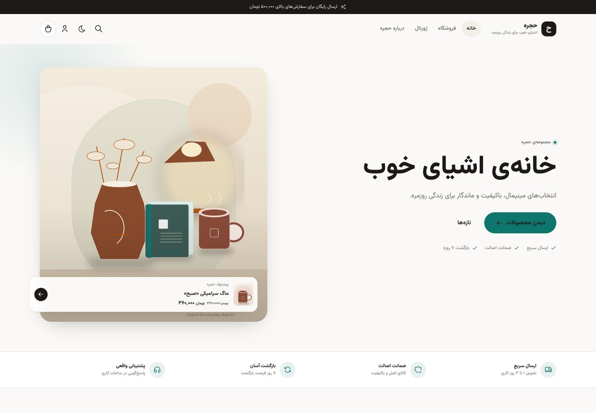
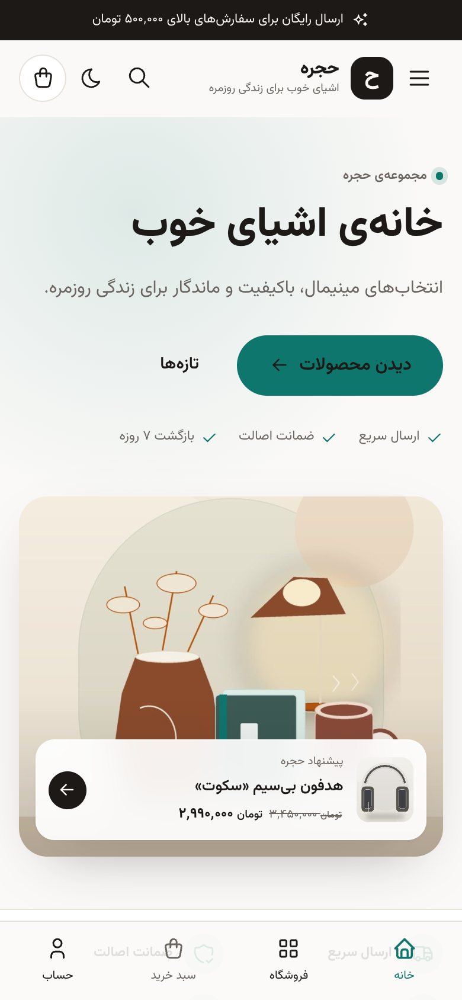
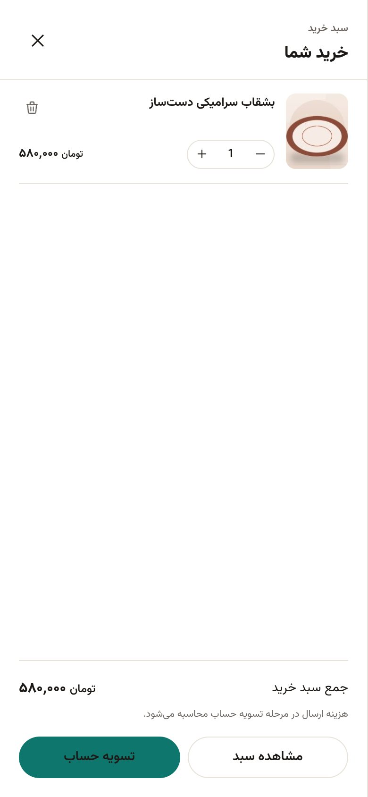
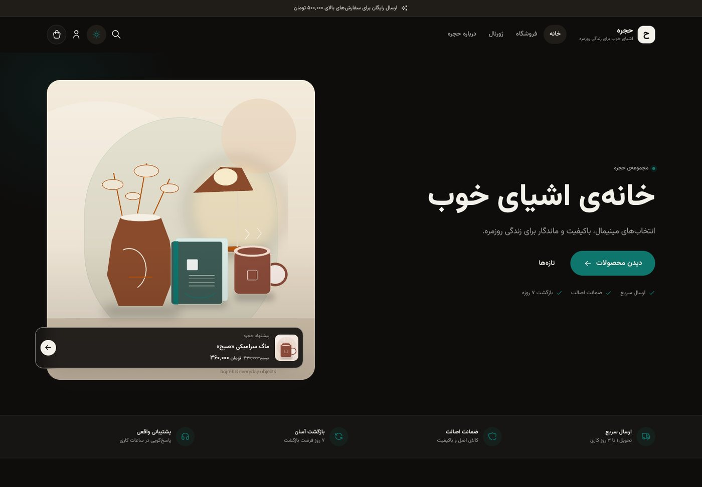

# حجره — قالب مینیمال و پرسرعت ووکامرس

قالب اختصاصی ووکامرس با طراحی مینیمال، **RTL**، فونت **وزیرمتن**، **Tailwind CSS 4**، حالت تیره، سبد خرید شناور و **افزودن به سبد خرید با AJAX**. تمام صفحات با کد نوشته شده‌اند و هیچ وابستگی به صفحه‌سازهایی مثل المنتور وجود ندارد.

- سایت: <http://localhost:8080>
- پیشخوان: <http://localhost:8080/wp-admin/>
- کاربر / رمز پیش‌فرض دمو: `admin` / `admin`
- صفحه نمایش هر چهار کارت محصول: <http://localhost:8080/card-demo/>

> این محیط برای توسعه و ارائه‌ی دمو ساخته شده است. پیش از انتشار عمومی، رمز عبور، کلیدهای امنیتی و تنظیمات سرور را تغییر دهید (بخش «چک‌لیست تولید»).

---

## نما

| دسکتاپ | موبایل | سبد شناور |
| --- | --- | --- |
|  |  |  |



---

## ۱. راه‌اندازی سریع

پیش‌نیازها: Docker Desktop، Node.js ۲۰+ و pnpm.

```bash
# در ریشه پروژه
./scripts/setup.sh
```

اسکریپت به‌صورت خودکار:

1. دیتابیس MariaDB و وردپرس را با Docker بالا می‌آورد.
2. وردپرس را نصب و زبان فارسی را فعال می‌کند.
3. ووکامرس را نصب و قالب «حجره» را فعال می‌کند.
4. دارایی‌های Tailwind را build می‌کند.
5. در صورت خالی بودن فروشگاه، ۱۴ محصول، ۵ دسته‌بندی، نظرات، پست‌های ژورنال، منوها، روش ارسال و درگاه «پرداخت در محل» را وارد می‌کند.

اگر می‌خواهید مراحل را دستی اجرا کنید:

```bash
docker compose up -d db wordpress
docker compose --profile cli run --rm wpcli wp core install \
  --url=http://localhost:8080 --title='حجره' \
  --admin_user=admin --admin_password=admin \
  --admin_email=admin@hojreh.local --skip-email

docker compose --profile cli run --rm --entrypoint sh wpcli -c '
  wp language core install fa_IR --activate
  wp plugin install woocommerce --activate
  wp language plugin install woocommerce fa_IR
  wp theme activate hojreh
  wp option update timezone_string Asia/Tehran
  wp rewrite structure "/%postname%/" --hard
'

pnpm install && pnpm build
docker compose --profile cli run --rm wpcli wp eval-file /scripts/seed.php
```

### سرویس‌ها

| سرویس | توضیح | پورت |
| --- | --- | --- |
| `wordpress` | وردپرس + Apache + PHP 8.3 | `8080` |
| `db` | MariaDB 11.4 با charset `utf8mb4` | داخلی |
| `wpcli` | ابزار مدیریت وردپرس (profile: `cli`) | — |

دیتابیس و فایل‌های وردپرس در volumeهای `db-data` و `wp-data` نگهداری می‌شوند. قالب به‌صورت bind mount در `wp-content/themes/hojreh` قرار دارد؛ تغییرات PHP بلافاصله اعمال می‌شوند.

---

## ۲. امکانات قالب

- **موبایل‌فرست**: طراحی از عرض ۳۶۰ پیکسل شروع می‌شود؛ شبکه‌ی محصولات در موبایل ۲ ستون، تبلت ۳ ستون و دسکتاپ قابل تنظیم (۲ تا ۴ ستون).
- **RTL کامل**: جهت صفحه اجباری RTL است؛ فاصله‌ها و چیدمان با propertyهای منطقی (`margin-inline`, `inset-inline`, ...) نوشته شده‌اند.
- **حالت تیره**: سیستم/روشن/تیره + ذخیره در `localStorage` + جلوگیری از فلش هنگام بارگذاری.
- **فونت وزیرمتن**: فایل variable woff2 به‌صورت self-host و preload می‌شود.
- **آیکون‌ها**: زیرمجموعه‌ی Tabler Icons به شکل Sprite استاتیک و قابل کش (بدون Font Awesome).
- **افزودن به سبد با AJAX**: کارت‌ها، صفحه محصول و فرم محصولات متغیر از طریق endpoint سبک `wc-ajax` ارسال می‌شوند.
- **سبد خرید شناور**: بعد از افزودن محصول، Drawer از سمت راست باز می‌شود؛ تغییر تعداد/حذف/جمع سبد بدون رفرش انجام می‌شود.
- **چهار مدل کارت محصول**: `minimal`، `overlay`، `bordered` و `horizontal` با شورت‌کد قابل انتخاب.
- **تنظیمات در پیشخوان**: یک صفحه سبک با بخش‌های برند، فروشگاه، صفحه اصلی و اطلاعات تماس.
- **بهبود صفحه محصول**: گالری گرید سبک، نشان تخفیف درصدی، امتیاز فارسی، اعتمادسازی، نوار خرید چسبان موبایل و تب‌های ساده.
- **بهبود سبد/تسویه**: کارت‌های ریسپانسیو سبد، فرم دو ستونه در دسکتاپ، خلاصه سفارش چسبان، حذف فیلدهای غیرضروری و متن‌های حریم خصوصی فارسی.
- **دسترس‌پذیری**: skip link، focus trap در Drawer، برچسب‌های aria، پشتیبانی از `prefers-reduced-motion` و کنتراست مناسب.
- **بدون jQuery در صفحات فروشگاه/فهرست**: فقط یک فایل CSS و یک فایل JS قالب بارگذاری می‌شود.

---

## ۳. ساختار پروژه

```text
.
├── docker-compose.yml
├── docker/wordpress/
│   ├── php.ini                    # opcache / upload limits
│   └── apache-hojreh.conf         # gzip + cache headers
├── theme/hojreh/
│   ├── functions.php
│   ├── style.css                  # هدر قالب
│   ├── inc/
│   │   ├── ajax-cart.php          # endpointهای سبد
│   │   ├── icons.php              # helper آیکون Tabler
│   │   ├── performance.php        # حذف دارایی‌های غیرضروری
│   │   ├── settings.php           # صفحه تنظیمات
│   │   ├── setup.php              # پشتیبانی‌ها، enqueue، RTL
│   │   ├── template-tags.php      # کارت‌ها، mini-cart، شورت‌کد
│   │   └── woocommerce.php        # هوک‌ها و استایل‌های ووکامرس
│   ├── woocommerce/
│   │   ├── content-product.php
│   │   └── single-product/rating.php
│   ├── header.php / footer.php
│   ├── front-page.php / page.php / page-card-demo.php
│   ├── index.php / archive.php / search.php / 404.php
│   ├── src/css/app.css            # طراحی و استایل‌های ووکامرس
│   ├── src/js/app.js              # سبد AJAX، Drawer، تم و منو
│   └── assets/
│       ├── dist/app.css|app.js    # خروجی build
│       ├── fonts/                 # وزیرمتن + مجوز OFL
│       └── icons/sprite.svg       # Tabler
├── scripts/
│   ├── setup.sh
│   ├── seed.php
│   ├── seed-assets/               # تصاویر دمو
│   ├── generate-images.py         # بازتولید تصاویر دمو
│   └── test-*.mjs                 # تست‌های Playwright
└── package.json
```

---

## ۴. توسعه‌ی فرانت‌اند

```bash
pnpm install

# حالت watch برای CSS
pnpm dev

# ساخت نهایی CSS + کپی JS به assets/dist
pnpm build
```

نکته: در حالت توسعه اگر فایل `src/js/app.js` را تغییر دادید، `pnpm build:js` (یا `pnpm build`) را اجرا کنید تا نسخه‌ی dist به‌روز شود. قالب از `filemtime` برای cache busting استفاده می‌کند؛ نیازی به تغییر دستی نسخه نیست.

- Tailwind 4 با پیکربندی CSS-first در `src/css/app.css`؛ توکن‌های رنگ به متغیرهای CSS متصل هستند.
- متغیرهای اصلی: `--accent`، `--page`، `--surface`، `--sunken`، `--line`، `--ink`، `--muted`.
- حالت تیره با کلاس `.dark` روی `<html>` و variant سفارشی `@custom-variant dark`.
- فونت و آیکون‌ها محلی هستند و هیچ درخواست خارجی در فرانت وجود ندارد.

---

## ۵. تنظیمات پیشخوان

مسیر: **پیشخوان → حجره**

| بخش | تنظیم |
| --- | --- |
| برند و ظاهر | رنگ اصلی، نوار اطلاع‌رسانی، حالت رنگی پیش‌فرض، نمایش دکمه تم |
| فروشگاه | کارت محصول پیش‌فرض، تعداد ستون دسکتاپ، نوار خرید چسبان موبایل |
| صفحه اصلی | عنوان/توضیح هیرو، تصویر هیرو، متن و لینک دکمه |
| اطلاعات تماس | تلفن، ایمیل، نشانی، اینستاگرام (نمایش در فوتر) |

رنگ اصلی به‌صورت CSS variable تزریق می‌شود و رنگ متن دکمه بر اساس روشنایی محاسبه می‌شود. اگر رنگ را تغییر دهید، هیچ فایل CSS دوباره build نمی‌شود.

---

## ۶. کارت‌های محصول

هر چهار کارت در صفحه‌ی <http://localhost:8080/card-demo/> نمایش داده شده‌اند.

| واریانت | مناسب برای |
| --- | --- |
| `minimal` | شبکه‌ی فروشگاه، جدیدترین‌ها |
| `overlay` | بخش منتخب، کمپین‌های بصری |
| `bordered` | دسته‌بندی ویژه، پیشنهادها |
| `horizontal` | لیست‌ها، نتایج جستجو، ستون کنار |

شورت‌کد:

```text
[hojreh_products card="minimal" limit="8" columns="4"]
[hojreh_products category="kitchen" limit="4" card="bordered" title="آشپزخانه"]
[hojreh_products on_sale="1" limit="4" card="overlay" title="تخفیف‌ها"]
[hojreh_products featured="1" limit="8" card="horizontal" orderby="date"]
```

| صفت | توضیح |
| --- | --- |
| `card` | `minimal` / `overlay` / `bordered` / `horizontal` |
| `columns` | ۲ تا ۴ (ستون دسکتاپ) |
| `limit` | حداکثر ۲۴ محصول |
| `category` | اسلاگ دسته یا چند دسته با کاما |
| `on_sale` | فقط محصولات تخفیف‌دار |
| `featured` | فقط محصولات منتخب |
| `orderby` | `date`, `price`, `popularity`, `rating`, `menu_order`, `rand` |
| `title` | عنوان بخش (اختیاری) |
| `link` | لینک «همه محصولات»؛ خالی بگذارید تا حذف شود |
| `class` | کلاس اضافی برای section |

کارت پیش‌فرض شبکه‌ی فروشگاه از تنظیمات قالب خوانده می‌شود و با فیلتر `hojreh_product_card_variant` هم قابل تغییر است.

---

## ۷. سبد خرید AJAX

- Nonce: `hojreh_cart`
- Endpointها (بدون بارگذاری کامل وردپرس، از مسیر `?wc-ajax=`):

| رویداد | کار |
| --- | --- |
| `hojreh_add_to_cart` | افزودن ساده یا متغیر + برگرداندن HTML Drawer |
| `hojreh_get_cart` | تازه‌سازی کامل سبد |
| `hojreh_update_cart` | تغییر تعداد با cart item key |
| `hojreh_remove_item` | حذف آیتم |

پاسخ JSON شامل `html`، `count`، `subtotal`، `empty` و `cart_url` است. شمارنده‌های هدر و نوار پایین با `data-cart-count` همگام می‌شوند. برای سازگاری با رویدادهای بومی ووکامرس، فیلتر `woocommerce_add_to_cart_fragments` هم پیاده شده است.

نکات پیاده‌سازی:

- کارت‌های ساده دکمه‌ی `<button data-hojreh-atc>` دارند تا بدون جاوااسکریپت لینک خراب نداشته باشیم.
- فرم محصولات متغیر با `variation_id` و `attribute_*` ارسال می‌شود.
- خطاها به‌صورت Toast بالای صفحه نمایش داده می‌شوند.
- Drawer تله‌ی فوکوس، بستن با Escape، بستن با کلیک پس‌زمینه و قفل اسکرول دارد.

---

## ۸. پرفورمنس

- در صفحه‌ی اصلی و فروشگاه فقط **یک CSS** و **یک JS** اختصاصی قالب بارگذاری می‌شود.
- استایل‌های پیش‌فرض ووکامرس (`woocommerce-general`, `layout`, `smallscreen`) حذف و با سیستم طراحی کوچک‌تر جایگزین شده‌اند.
- `wc-cart-fragments`، `sourcebuster`، `order-attribution` و اسکریپت‌های غیرلازم ووکامرس از صفحات غیرفروشگاهی حذف می‌شوند.
- Global Styles و Block Library در قالب کلاسیک حذف می‌شوند.
- فونت preload، تصاویر lazy، `srcset` و ابعاد مشخص، SVG Sprite کش‌شونده.
- Apache دمو gzip و cache یک‌ماهه برای CSS/JS/تصاویر فعال می‌کند.
- CSS نهایی minified است و JS بدون وابستگی (Vanilla) نوشته شده است.

برای مشاهده‌ی فهرست درخواست‌ها:

```bash
node scripts/audit-assets.mjs
```

---

## ۹. تست

تست‌های خودکار Playwright در برابر سایت در حال اجرا کار می‌کنند (Chrome نصب باشد):

```bash
node scripts/test-ui.mjs       # Drawer، تغییر تعداد، سبد، Dark و موبایل
node scripts/test-shots.mjs    # اسکرین‌شات صفحات اصلی و حالت‌ها
node scripts/test-flows.mjs    # حذف از سبد، جستجو، 404، دمو کارت‌ها
node scripts/test-errors.mjs   # خطای موجودی، اعتبارسنجی فرم و کد تخفیف
node scripts/test-admin.mjs    # صفحه تنظیمات و ذخیره‌ی گزینه‌ها
```

خروجی تصویری در پوشه‌ی `screenshots/` ذخیره می‌شود.

تست دستی سریع:

1. یک محصول را از فروشگاه اضافه کنید → Drawer از راست باز شود.
2. تعداد را در Drawer تغییر دهید → مبلغ و شمارنده به‌روز شوند.
3. صفحه محصول → افزودن به سبد و نوار چسبان موبایل.
4. تغییر تم → رفرش صفحه → تم حفظ شود.
5. سبد → کد تخفیف نامعتبر → پیام خطا.
6. تسویه حساب با «پرداخت در محل» → صفحه سفارش دریافت شد.

---

## ۱۰. بازنشانی کامل

```bash
docker compose down -v   # حذف دیتابیس و فایل‌های وردپرس
./scripts/setup.sh
```

این دستور **همه‌ی داده‌ها** (سفارش‌ها، محصولات، تنظیمات) را پاک می‌کند.

---

## ۱۱. چک‌لیست تولید

- `WP_DEBUG` را خاموش کنید و `WP_DEBUG_LOG`/`WP_DEBUG_DISPLAY` را مدیریت کنید.
- رمز `admin` را تغییر دهید و کاربر مدیر جدید بسازید.
- `WP_HOME`/`WP_SITEURL` را به دامنه‌ی واقعی تغییر دهید.
- SSL، SMTP (برای ایمیل سفارش)، بکاپ دیتابیس و آپلودها را فعال کنید.
- درگاه پرداخت واقعی (زرین‌پال/آی‌دی‌پی و…) را نصب و تنظیم کنید؛ COD فقط برای دمو است.
- تنظیمات مالیات، مناطق ارسال و هزینه‌ها را بازبینی کنید.
- Object Cache (Redis) و CDN را در صورت نیاز اضافه کنید.
- صفحه‌ی سبد/تسویه را با شورت‌کدهای کلاسیک نگه دارید (نه بلوک) تا استایل و پرفورمنس فعلی حفظ شود.

---

## ۱۲. محدوده و وابستگی‌ها

- قالب برای ووکامرس کلاسیک (shortcode) بهینه شده است؛ اگر بعداً Cart/Checkout Block را فعال کنید، برخی استایل‌های بلوک لازم می‌شوند.
- هیچ صفحه‌ساز یا افزونه‌ی اجباری استفاده نشده است.
- برای گرفتن خروجی قابل نصب قالب، فایل `hojreh-theme-1.0.0.zip` در ریشه‌ی پروژه ساخته شده است.
- لایسنس قالب: GPL-2.0-or-later. مجوز فونت وزیرمتن (OFL) و آیکون‌های Tabler (MIT) در `theme/hojreh/assets/LICENSES.md` آمده است.
